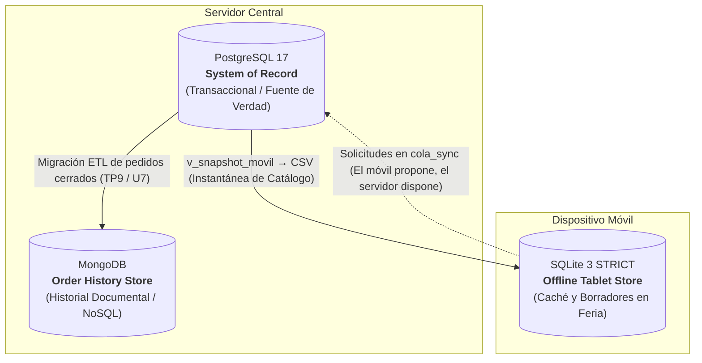

# Food Store — Capa de Datos (Base de Datos II)

**Institución:** Universidad Tecnológica Nacional — Facultad Regional Mendoza (UTN FRM)  
**Carrera:** Tecnicatura Universitaria en Programación (TUP)  
**Cátedra:** Base de Datos II  
**Docente:** Sergio Neira  
**Alumno:** Máximo Juan Cruz Quiroga (`maximoj.quiroga@alumnos.frm.utn.edu.ar`)  
**Ciclo Lectivo:** 2026  
**Repositorio:** [github.com/Maximoquirogaa/foodstore](https://github.com/Maximoquirogaa/foodstore)

---

## 1. Descripción General del Proyecto

Este repositorio reúne la evolución completa de la **capa de datos del Trabajo Práctico Integrador «Food Store»** a lo largo de los trabajos prácticos **TP2 al TP10** de la cátedra Base de Datos II.

Partiendo del diseño relacional transaccional en **PostgreSQL 17**, el proyecto avanza de forma progresiva por integridad y concurrencia, carga masiva y optimización de consultas, indexado estratégico, vistas y vistas materializadas, normalización en FNBC y desnormalización controlada, administración y seguridad por mínimo privilegio, respaldo y recuperación ante desastres, hasta culminar en una **arquitectura de persistencia políglota** que integra **MongoDB** para el historial documental de pedidos y **SQLite 3 (`STRICT`)** para operación móvil *offline* en feria.

> **Informe Técnico Consolidado (Segunda Entrega — Unidades 4 a 8):**  
> Disponible en la raíz del repositorio: [`Informe_Tecnico_Entrega2_Maximo_Quiroga.pdf`](Informe_Tecnico_Entrega2_Maximo_Quiroga.pdf).

---

## 2. Arquitectura de la Capa de Datos (Persistencia Políglota)

Food Store coordina **tres motores de bases de datos especializados** según el patrón de acceso, los requerimientos de consistencia y la tolerancia a la desconexión:



| Motor | Base / Colección | Responsabilidad Principal | Autoridad |
|---|---|---|---|
| **PostgreSQL 17** | `foodstore_dev` / `foodstore_tp3_carga` | Catálogo maestro, precios vigentes, stock real, clientes, usuarios, auditoría, seguridad y pedidos confirmados. | **Única fuente de verdad (*System of Record*).** |
| **MongoDB** | `foodstore_nosql.pedidos` | Pedidos cerrados desnormalizados con subdocumento de cliente y líneas embebidas para lectura rápida sin `JOIN`s. | **Derivada (solo lectura histórica).** |
| **SQLite 3 (`STRICT`)** | `foodstore_movil.db` | Caché local de catálogo (precios en centavos enteros), borradores locales y cola del semáforo de sincronización. | **Sin autoridad sobre inventario ni ventas firmes.** |

### Modelo Relacional Canónico (PostgreSQL)

El núcleo relacional definido en [`TP2_Concurrencia_IA/schema.sql`](TP2_Concurrencia_IA/schema.sql) y extendido en los módulos posteriores se compone de:

- **`categorias`** (`id_categoria`, `nombre`, `activo`, `fecha_creacion`)
- **`clientes`** (`id_cliente`, `nombre`, `apellido`, `correo_electronico`, `fecha_creacion`)
- **`productos`** (`id_producto`, `id_categoria`, `nombre`, `precio_actual`, `stock`, `activo`, `fecha_creacion`)
- **`pedidos`** (`id_pedido`, `id_cliente`, `forma_pago` ENUM `'EFECTIVO' | 'TARJETA' | 'TRANSFERENCIA'`, `fecha_pedido`)
- **`detalles_pedido`** (`id_pedido`, `id_producto`, `cantidad`, `precio_unitario` — precio congelado al momento de compra)
- **`usuarios`** (incorporada en [`TP5_Indices_Vistas`](TP5_Indices_Vistas/README.md) / [`TP7_Administracion_y_Seguridad`](TP7_Administracion_y_Seguridad/README.md) con `rol` y contraseñas hasheadas con `pgcrypto` bcrypt)

Reglas de negocio transversales: baja lógica preferida mediante `activo = TRUE/FALSE` (sin borrado físico de registros históricos), restricciones `CHECK` de no negatividad en precios y stock, y preservación del precio histórico en `detalles_pedido.precio_unitario`.

---

## 3. Mapa de Trabajos Prácticos

| Módulo | Unidad / Temática | Motor(es) | Aspectos y Resultados Principales | Documentación |
|---|---|---|---|---|
| **TP2** | Integridad, Triggers y Concurrencia | PostgreSQL | Esquema canónico (`schema.sql`), triggers `fn_check_producto_activo` y `fn_deducir_stock` (`restricciones.sql`), análisis de MVCC, bloqueos y lectura crítica. | [`TP2_Concurrencia_IA/DUIA.md`](TP2_Concurrencia_IA/DUIA.md) |
| **TP3** | Carga Masiva y Optimización | PostgreSQL | Poblado volumétrico con `generate_series` (`carga_masiva.sql`: 20k clientes, 50k productos, 200k pedidos), análisis con `EXPLAIN ANALYZE`, índices y validación con `EXCEPT`. | [`TP3_Optimizacion/DUIA.md`](TP3_Optimizacion/DUIA.md) |
| **TP4** | Reportes Analíticos, Joins y Competencia | PostgreSQL | Index Only Scan en Consulta A (**699,55 ms → 164,25 ms**, ~4,26x); lectura crítica de 7 afirmaciones de IA; `DENSE_RANK()` validado con `EXCEPT` (0 filas); `SET LOCAL work_mem = '8MB'` en competencia (**621,0 ms → 571,4 ms**) y control de sesgo A-B-A-B-A-B. | [`TP4_Reportes_Analiticos/README.md`](TP4_Reportes_Analiticos/README.md) |
| **TP5** | Índices, Vistas y Vista Materializada | PostgreSQL | Costo de escritura en `INSERT` (+33,5% / +72,2%); descarte de BRIN (`correlation = 0.0051`) e índices redundantes; 5 vistas seguras y rol `TP5_reportes`; vista materializada `mv_resumen_ventas_categoria_mes` (**976,12 ms → 0,054 ms**, ~18.076x) con `REFRESH CONCURRENTLY`. | [`TP5_Indices_Vistas/README.md`](TP5_Indices_Vistas/README.md) |
| **TP6** | **U4:** FNBC y Desnormalización Controlada | PostgreSQL | Descomposición FNBC de `control_lote_almacen` en `responsable_deposito` y `control_lote` (sin pérdida, validado con `EXCEPT`); desnormalización del *Top 5 diario de categorías* con 3 columnas caché, índice y 3 triggers (**48,42 ms → 1,65 ms**, ~29,32x, −94,84% búferes). | [`TP6_FNBC_Desnormalizacion/README.md`](TP6_FNBC_Desnormalizacion/README.md) |
| **TP7** | **U5:** Administración y Seguridad | PostgreSQL | Especificación Kiro (`RF-01` a `RF-07`); 5 roles `NOLOGIN` + `app_web` y `admin_datos`; funciones `fn_autenticar` y `fn_resetear_password` (`SECURITY DEFINER`); auditoría nativa; simulacro de incidente (`SQLSTATE 42501`); anonimización `usuarios_anon` verificada con `EXCEPT ALL`. | [`TP7_Administracion_y_Seguridad/README.md`](TP7_Administracion_y_Seguridad/README.md) |
| **TP8** | **U6:** Mantenimiento, Respaldo y Recuperación | PostgreSQL / PowerShell | Respaldo `pg_dump -Fc` y restauración automatizada (`backup_foodstore.ps1`, `restore_test.ps1`); RTO observado de **2,58 s** (`foodstore_dev`) y **9,15 s** (`foodstore_tp3_carga`, 769.584 filas) para meta ≤ 15 min; 9 controles con 0 anomalías; `health_check.sql`, `maintenance.sql` y 14 checks PASS. | [`TP8_Mantenimiento_Respaldo_Recuperacion/README.md`](TP8_Mantenimiento_Respaldo_Recuperacion/README.md) |
| **TP9** | **U7:** NoSQL y Migración Documental | MongoDB + PostgreSQL | Colección `foodstore_nosql.pedidos` con patrón embebido; validación `$jsonSchema` y `$expr` (rechazo código 121); 4 consultas con paridad 100% de IDs respecto a PostgreSQL (`[1, 3, 5]` y `[1, 2, 4]`); ETL Python y contraste crítico de IA. | [`nosql/TP9_MongoDB_NoSQL/README.md`](nosql/TP9_MongoDB_NoSQL/README.md) |
| **TP10** | **U8:** Base Móvil Offline y Cierre de Capa de Datos | SQLite 3 + PostgreSQL | Esquema `STRICT` con precios en centavos enteros; recarga atómica con `UPSERT`; semáforo de sincronización (`RECHAZADO > CONFLICTO > SIMULADO_APROBADO`); casos C2–C6 automatizados en `simulador.py`; mapa tri-motor, plan de contingencia ampliado, code review F01–F10 y spec EARS (`docs/kiro/`). | [`nosql/TP10_Movil_SQLite/README.md`](nosql/TP10_Movil_SQLite/README.md) |

---

## 4. Estructura del Repositorio

```text
foodstore_github/
├── README.md                                       <- Este documento general
├── Informe_Tecnico_Entrega2_Maximo_Quiroga.pdf     <- Informe técnico consolidado (Unidades 4 a 8)
├── TP2_Concurrencia_IA/                            <- Esquema base, triggers de integridad y DUIA TP2
├── TP3_Optimizacion/                               <- Carga masiva (generate_series) y DUIA TP3
├── TP4_Reportes_Analiticos/                        <- Partes 1 a 4: joins, lectura crítica, EXCEPT y competencia
├── TP5_Indices_Vistas/                             <- Plan de indexado, costo de escritura, vistas y MV
├── TP6_FNBC_Desnormalizacion/                      <- U4: FNBC en control de lotes y desnormalización Top 5
├── TP7_Administracion_y_Seguridad/                 <- U5: Roles, auditoría, simulacro, anonimización y Kiro spec
├── TP8_Mantenimiento_Respaldo_Recuperacion/        <- U6: Backups pg_dump, RTO/RPO, health_check, tests y SHA-256
└── nosql/
    ├── TP9_MongoDB_NoSQL/                          <- U7: Colección pedidos, $jsonSchema/$expr, ETL y consultas
    └── TP10_Movil_SQLite/                          <- U8: SQLite STRICT, semáforo C2–C6, simulador y cierre
```

---

## 5. Metodología de Trabajo y Uso Responsable de IA

Todas las unidades del proyecto aplican un protocolo común de verificación empírica:

1. **Transacciones reversibles:** Las pruebas con efectos de escritura sobre PostgreSQL se ejecutan en bloques `BEGIN ... ROLLBACK` (con `SAVEPOINT` cuando corresponde) para preservar el estado de las bases de laboratorio.
2. **Medición controlada:** Las optimizaciones se evalúan con `EXPLAIN (ANALYZE, BUFFERS)` y rondas intercaladas para descartar sesgos de caché en caliente y falsos positivos.
3. **Equivalencia formal:** La refactorización de consultas, vistas, descomposición FNBC y anonimización se valida matemáticamente mediante `EXCEPT` / `EXCEPT ALL` bidireccional exigiendo **0 filas de discrepancia**.
4. **Especificación y auditoría de IA:** Las entregas incorporan especificaciones formales (`docs/kiro_roles_spec/`, `SPEC_U6.md`, `docs/kiro/` en notación EARS) y bitácoras **DUIA** donde se documentan tanto las propuestas aceptadas como las rechazadas o refutadas (por ejemplo, rechazo de `GRANT ALL`, descarte de índices redundantes o BRIN sin correlación física, y refutación de afirmaciones sobre MongoDB y baja lógica en SQLite).

---

## 6. Guía Rápida de Ejecución

### Requisitos Previos
- **PostgreSQL 17** (herramientas `psql`, `pg_dump`, `pg_restore`, `createdb`).
- **MongoDB** y `mongosh` (para TP9).
- **Python 3** (con soporte `sqlite3` estándar para TP10 y `pymongo` si se ejecuta el ETL de TP9).
- **PowerShell** (para los scripts de respaldo, restauración y pruebas de TP8 en Windows).

### Comandos de Referencia por Etapa

```powershell
# 1. Crear esquema canónico y carga masiva en PostgreSQL (TP2 / TP3 / TP5)
psql -U postgres -d foodstore_dev -f "TP2_Concurrencia_IA/schema.sql"
psql -U postgres -d foodstore_dev -f "TP2_Concurrencia_IA/restricciones.sql"
psql -U postgres -d foodstore_tp3_carga -f "TP5_Indices_Vistas/schema.sql"
psql -U postgres -d foodstore_tp3_carga -f "TP5_Indices_Vistas/data.sql"

# 2. Verificar suite automatizada de respaldo y recuperación (TP8 - sin conexión a motor)
powershell.exe -NoProfile -ExecutionPolicy RemoteSigned -File "TP8_Mantenimiento_Respaldo_Recuperacion/pruebas/test_delivery.ps1"

# 3. Ejecutar migración y consultas NoSQL en MongoDB (TP9)
mongosh "mongodb://localhost:27017" "nosql/TP9_MongoDB_NoSQL/migracion_pedidos.js"
mongosh "mongodb://localhost:27017" "nosql/TP9_MongoDB_NoSQL/consultas_mongodb.js"

# 4. Ejecutar simulador completo de la tablet offline y semáforo (TP10)
python "nosql/TP10_Movil_SQLite/movil/simulador.py"
```

Para instrucciones detalladas de cada módulo (despliegue de roles, simulacro de incidentes, scripts de FNBC/desnormalización y ejecución paso a paso), consultar el `README.md` específico dentro de cada carpeta.
