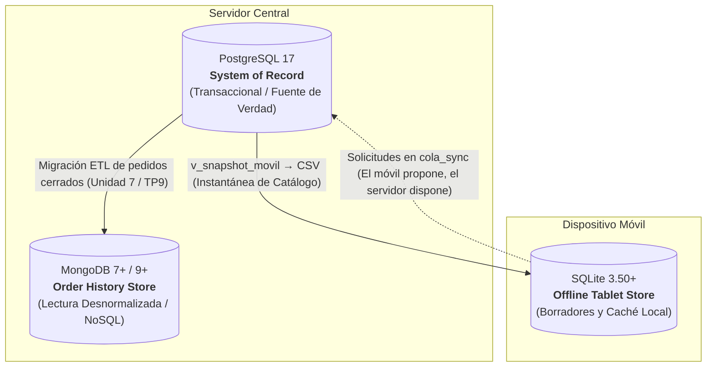

# Consigna 3.a — Mapa de la Capa de Datos Unificada

Food Store implementa una arquitectura híbrida de tres motores de bases de datos coordinados. Cada motor cumple una función especializada según el patrón de acceso y la tolerancia a la desconexión:

## Comparativa de Roles por Motor

| Motor | Base / Esquema | ¿Qué guarda? | Patrón de Acceso | ¿Tiene Autoridad? |
|---|---|---|---|:---:|
| **PostgreSQL 17** | `foodstore_dev` | Catálogo de productos, categorías, usuarios autenticados, clientes, stock en tiempo real, auditoría y pedidos confirmados. | OLTP transaccional de alta concurrencia con transacciones ACID estrictas. | **SÍ (Manda sobre todo).** Es la única fuente de verdad contable y de inventario. |
| **MongoDB** | `foodstore_nosql.pedidos` | Documentos completos de pedidos históricos cerrados con líneas embebidas y snapshot congelado del cliente. | OLAP / Lectura rápida sin JOINs para emisión de tickets y consumo de APIs móviles. | **NO.** Es una proyección derivada; ante discrepancias prevalece PostgreSQL. |
| **SQLite 3** | `foodstore_movil.db` | Caché local del catálogo (`producto_cache`), borradores temporales (`pedido_borrador`), ítems y estado del semáforo (`cola_sync`). | Almacenamiento local embebido offline para operar en ferias sin conexión a Internet. | **NO (Solo sobre borradores locales).** No puede autorizar ventas ni modificar inventario en el servidor. |

## Matriz de Autoridad por Atributo

| Atributo de Negocio | Decide / Manda | Copia en MongoDB | Copia en SQLite (Tablet) |
|---|---|---|---|
| **Precio Vigente** | PostgreSQL (`productos.precio_actual`) | No se almacena (solo guarda histórico de venta) | `precio_centavos` (Precio visto temporal) |
| **Stock Disponible** | PostgreSQL (`productos.stock`) | No interviene | `stock_visto` (Control preliminar offline) |
| **Baja Lógica / Estado** | PostgreSQL (`productos.activo`) | No interviene | `disponible` y `eliminado` (0 o 1) |
| **Venta Confirmada** | PostgreSQL (`pedidos`, `detalles_pedido`) | Sí, como documento cerrado | **Nunca.** La tablet solo emite borradores |
| **Precio Histórico de Venta**| PostgreSQL (`detalles_pedido.precio_unitario`) | Sí (`lineas.precio_unitario`) | `precio_centavos_visto` (en borrador) |
| **Datos de Clientes / Passwords** | PostgreSQL (`clientes`, `usuarios`) | Solo datos básicos de snapshot | **No viajan por seguridad y privacidad** |
