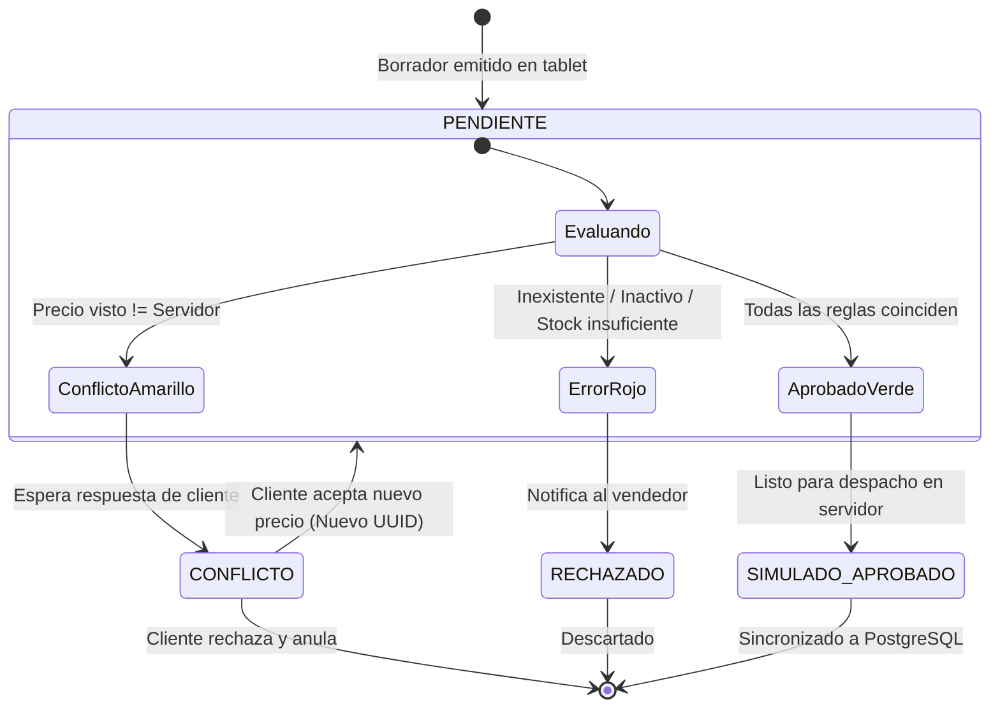

# Documento de Diseño Técnico (Kiro Design)

**Componente:** Módulo Móvil Offline y Motor de Semáforo  
**Plataforma:** SQLite 3 (Modo STRICT)  
**Autor:** Máximo Juan Cruz Quiroga  

---

## 1. Máquina de Estados del Semáforo

## 2. Precedencia de Evaluación
1. **Regla de Rechazo (Prioridad 1 - Rojo):** Si existe al menos un ítem inexistente, no disponible, dado de baja o con cantidad mayor al stock disponible, la solicitud pasa a `RECHAZADO`.
2. **Regla de Conflicto de Precios (Prioridad 2 - Amarillo):** Si superó la regla 1 pero el precio visto difiere del precio vigente en el servidor, pasa a `CONFLICTO`.
3. **Regla de Coincidencia Total (Prioridad 3 - Verde):** Si superó las dos anteriores, pasa a `SIMULADO_APROBADO`.
